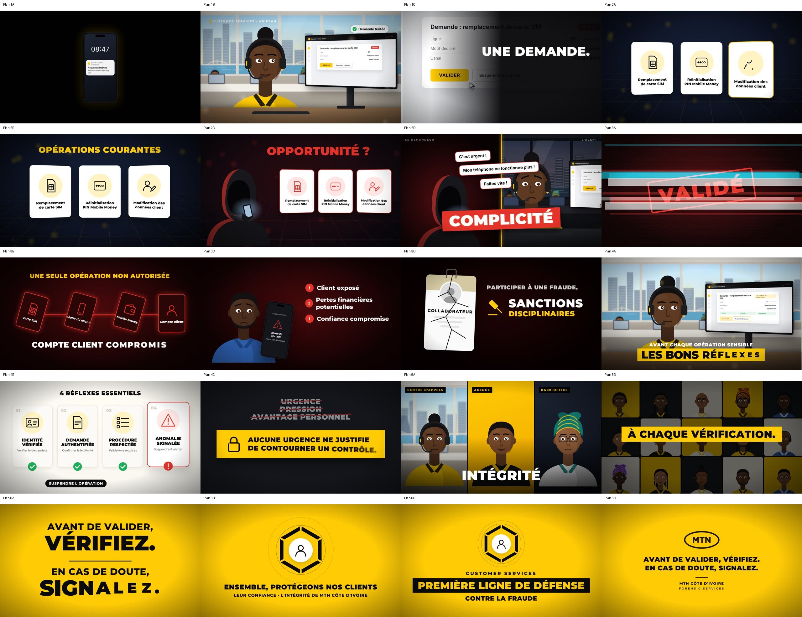

# UNE SEULE ACTION PEUT TOUT CHANGER : dossier de pré-production

**Client interne :** MTN Côte d'Ivoire, Customer Services · **Initiateur :** Forensic Services
**Format :** MP4 H.264, 1920 × 1080, 30 i/s, AAC 48 kHz stéréo, -16 LUFS
**Durée :** 99 s (voix-off fournie : 93,6 s, plus 1,5 s d'ouverture à froid et 4 s d'écran de clôture)
**Livrables :** version sans sous-titres, version avec sous-titres incrustés, fichier `.srt` séparé

---

## 1. Parti pris de réalisation

| Sujet | Choix |
|---|---|
| Style | Motion design 2D premium : personnages ivoiriens illustrés, décors (plateau Customer Services avec vue sur le Plateau et la lagune Ébrié), interfaces animées, typographie cinétique. Mouvements de caméra (dolly, push-in, zooms), profondeur de champ (arrière-plans flous), grain, vignettage, glitch numérique. |
| Palette | Jaune MTN `#FFCB05`, noir, blanc. Rouge `#E5332A` réservé au danger (scènes 2 et 3), vert `#1FAF5A` réservé aux validations (scène 4). |
| Typographie | Montserrat 800/900 pour les titres, Inter pour l'interface et les sous-titres. |
| Logo | Uniquement le fichier MTN fourni, détouré sans modification (noir sur fond jaune), sur l'écran de clôture. |
| Interfaces | Console fictive et générique, mentionnée « Interface simulée – à des fins de sensibilisation ». Numéro masqué (`07 •• •• •• ••`). Aucune donnée personnelle, aucun outil interne réel, aucun mode opératoire de fraude détaillé. |
| Ton | Responsabilisant, pas culpabilisant. Le danger (rouge) bascule vers la solution (jaune, lumière) dès « adoptons les bons réflexes ». |
| Plans réalistes | Les prompts de la section 4 permettent de générer des plans prises de vue réelles (Veo, Runway, Kling, Sora…) pour remplacer ou compléter les plans illustrés. Ils reprennent les cadrages et les minutages du storyboard. |

## 2. Minutage de la voix-off

Minutage mesuré sur le fichier ElevenLabs (transcription automatique, puis recalage sur les silences). Les temps sont en **temps vidéo** (voix-off + 1,5 s).

| # | Début | Fin | Texte | Scène |
|---|---|---|---|---|
| 1 | 01,50 | 05,01 | Chaque jour, au sein de Customer Services, nous accompagnons des milliers de clients. | 1 |
| 2 | 05,37 | 09,38 | Nous répondons à leurs demandes, résolvons leurs difficultés et facilitons leur quotidien. | 1 |
| 3 | 09,97 | 13,91 | Mais derrière une demande apparemment ordinaire… peut se cacher une tentative de fraude. | 1 |
| 4 | 14,48 | 15,86 | Un remplacement de carte SIM. | 2 |
| 5 | 16,26 | 19,13 | Une réinitialisation de code PIN Mobile Money. | 2 |
| 6 | 19,56 | 21,45 | Une modification des informations d'un client. | 2 |
| 7 | 21,94 | 23,71 | Pour nous, ce sont des opérations courantes. | 2 |
| 8 | 24,12 | 27,81 | Pour un fraudeur, elles peuvent représenter une opportunité. | 2 |
| 9 | 28,26 | 33,46 | Les fraudeurs exploitent l'urgence, la confiance, la négligence… et parfois même la complicité. | 2 |
| 10 | 33,99 | 41,42 | Une seule opération non autorisée peut suffire à compromettre le compte d'un client, provoquer des pertes financières et ternir la réputation de notre entreprise. | 3 |
| 11 | 41,98 | 48,14 | Et lorsqu'un collaborateur participe volontairement à une fraude, il s'expose à de lourdes conséquences disciplinaires et judiciaires. | 3 |
| 12 | 48,79 | 52,42 | Alors, avant chaque opération sensible, adoptons les bons réflexes. | 4 |
| 13 | 52,90 | 55,07 | Vérifions systématiquement l'identité du demandeur. | 4 |
| 14 | 55,57 | 57,98 | Assurons-nous de la légitimité de chaque opération. | 4 |
| 15 | 58,50 | 61,43 | Respectons les procédures et les niveaux de validation requis. | 4 |
| 16 | 62,15 | 66,75 | Et face à une situation suspecte, n'hésitons jamais à suspendre l'opération et à donner l'alerte. | 4 |
| 17 | 67,14 | 72,58 | Car aucune urgence, aucune pression et aucun avantage personnel ne justifient de contourner nos contrôles. | 4 |
| 18 | 73,46 | 77,58 | La lutte contre la fraude n'est pas uniquement la responsabilité de Forensic Services. | 5 |
| 19 | 77,86 | 79,00 | Elle commence avec chacun de nous. | 5 |
| 20–22 | 79,42 | 82,41 | À chaque interaction. À chaque vérification. À chaque décision. | 5 |
| 23 | 82,93 | 84,27 | Avant de valider, vérifiez. | 6 |
| 24 | 84,37 | 85,71 | En cas de doute, signalez. | 6 |
| 25 | 86,28 | 90,75 | Ensemble, protégeons nos clients, leur confiance et l'intégrité de MTN Côte d'Ivoire. | 6 |
| 26 | 91,14 | 94,63 | Customer Services : soyons la première ligne de défense contre la fraude. | 6 |

**Découpage :** S1 0–14,2 s · S2 14,2–33,7 s · S3 33,7–48,5 s · S4 48,5–73,1 s · S5 73,1–82,7 s · S6 82,7–99 s.
Ces bornes diffèrent de celles du brief (0–12 / 12–28 / 28–43 / 43–65 / 65–78 / 78–90) parce que la voix-off réelle dure 93,6 s. Chaque scène reste calée sur les phrases qui la concernent.

## 3. Storyboard scène par scène

Vignettes : `storyboard/` (une image par plan, extraite du rendu), avec la planche complète dans `storyboard/planche-storyboard.jpg`.



### Scène 1 : Le danger invisible (0–14,2 s)
| Plan | Temps | Visuel | Texte écran | Son |
|---|---|---|---|---|
| 1A | 0–1,9 | Écran noir. Un smartphone s'allume. Notification « Nouvelle demande – Remplacement de carte SIM ». Plongée de la caméra dans l'écran. | (aucun) | Notification (0,45 s), whoosh, flash |
| 1B | 1,9–9,6 | Plateau Customer Services à Abidjan, baie vitrée sur le Plateau et la lagune. Une agente (casque, polo jaune) parle à un client. Collègues flous en arrière-plan. Dolly arrière lent. | Libellé « Customer Services · Abidjan ». Puces « ✓ Demande traitée / Difficulté résolue / Client accompagné » | Drone grave, pulsation |
| 1C | 9,6–14,2 | Push-in sur l'écran, puis console plein cadre (demande SIM, étiquette « URGENT » clignotante). Le curseur glisse vers VALIDER, zoom sur le bouton, l'image s'assombrit. | « UNE DEMANDE. » puis « UN RISQUE. » (rouge) | Impact sur « fraude », pulsation rouge, glitch de transition |

### Scène 2 : Le piège (14,2–33,7 s)
| Plan | Temps | Visuel | Texte écran | Son |
|---|---|---|---|---|
| 2A | 14,2–21,9 | Fond nuit, grille en perspective. Trois cartes 3D arrivent une par une, synchronisées sur la voix : carte SIM (icône tracée), PIN Mobile Money (points qui se remplissent), modification des données (profil + crayon). | Libellés des cartes | Pop sur chaque carte |
| 2B | 21,9–24,1 | Les trois cartes alignées, calmes. | « OPÉRATIONS COURANTES » (jaune) | Scintillement |
| 2C | 24,1–28,2 | Une silhouette encapuchonnée (visage dans l'ombre, éclairée par son téléphone) entre à gauche. Les cartes virent au rouge. | « OPPORTUNITÉ ? » (rouge, glitch) | Impact sourd |
| 2D | 28,2–33,7 | Écran partagé : le demandeur à gauche, l'agente hésitante à droite. Bulles de pression : « C'est urgent ! », « Mon téléphone ne fonctionne plus ! », « Faites vite ! ». Le curseur hésite, puis clique. | Mots-chocs synchronisés : URGENCE · CONFIANCE · NÉGLIGENCE · COMPLICITÉ | Tic-tac qui accélère, impacts, clic |

> Le brief prévoyait « URGENCE / MANIPULATION / FRAUDE ». Les mots ont été alignés sur la voix-off finale (urgence, confiance, négligence, complicité). La version du brief reste possible : il suffit de modifier les mots dans `src/scenes/S2.tsx`.

### Scène 3 : Les conséquences (33,7–48,5 s)
| Plan | Temps | Visuel | Texte écran | Son |
|---|---|---|---|---|
| 3A | 33,7–34,5 | Tampon « VALIDÉ » rouge : représentation fictive d'une validation non conforme. | VALIDÉ | Glitch + boom |
| 3B | 34,2–37,3 | Effet domino : Carte SIM → Ligne du client → Mobile Money → Compte client. Les dominos basculent et une ligne rouge se propage. | « UNE SEULE OPÉRATION NON AUTORISÉE » · « COMPTE CLIENT COMPROMIS » | Claquements de dominos |
| 3C | 37,3–41,9 | Le client légitime, inquiet. Son téléphone affiche « Aucun service · Alerte de sécurité · Carte SIM désactivée ». | Client exposé · Pertes financières potentielles · Confiance compromise (aucun montant) | Alarme deux tons |
| 3D | 41,9–48,5 | Badge « Collaborateur » qui se fissure. Un marteau de juge tombe. | « PARTICIPER À UNE FRAUDE, » · SANCTIONS DISCIPLINAIRES & JUDICIAIRES | Craquement, coup de marteau |

### Scène 4 : Les bons réflexes (48,5–73,1 s)
| Plan | Temps | Visuel | Texte écran | Son |
|---|---|---|---|---|
| 4A | 48,5–52,6 | Halo lumineux, le plateau devient clair. L'agente, concentrée, a suspendu l'opération : la console affiche « En attente de vérification » et les contrôles se cochent. | « AVANT CHAQUE OPÉRATION SENSIBLE » · « LES BONS RÉFLEXES » | La musique bascule en majeur |
| 4B | 52,6–67,0 | Quatre cartes-pictogrammes apparaissent sur chaque phrase : 01 Identité vérifiée ✓ · 02 Demande authentifiée ✓ · 03 Procédure respectée ✓ · 04 Anomalie signalée ⚠ (symbole d'alerte, pas de coche). | Pastilles « SUSPENDRE L'OPÉRATION » et « DONNER L'ALERTE » | Ding de validation ×3, alerte douce |
| 4C | 67,0–73,1 | Sur fond sombre, URGENCE, PRESSION et AVANTAGE PERSONNEL apparaissent puis sont barrés en rouge. Bandeau jaune avec cadenas. | « AUCUNE URGENCE NE JUSTIFIE DE CONTOURNER UN CONTRÔLE. » | Swish de rature, impact |

### Scène 5 : La responsabilité individuelle (73,1–82,7 s)
| Plan | Temps | Visuel | Texte écran | Son |
|---|---|---|---|---|
| 5A | 73,1–77,8 | Triptyque de trois agents : centre d'appels, agence, back-office. Panneaux en glissement alterné, léger push-in. | VIGILANCE → INTÉGRITÉ → RESPONSABILITÉ | Whooshs, impacts doux, rythmique |
| 5B | 77,8–82,7 | Mosaïque de 15 portraits de collaborateurs qui s'assemblent (protection collective). Volet circulaire jaune vers la scène 6. | « CHACUN DE NOUS » puis À CHAQUE INTERACTION. / VÉRIFICATION. / DÉCISION. | Scintillement, impacts |

### Scène 6 : Le message final (82,7–99 s)
| Plan | Temps | Visuel | Texte écran | Son |
|---|---|---|---|---|
| 6A | 82,7–86,3 | Fond jaune MTN, typographie noire. | AVANT DE VALIDER, **VÉRIFIEZ.** / EN CAS DE DOUTE, **SIGNALEZ.** | Impacts |
| 6B | 86,3–91,1 | Un bouclier numérique (segments hexagonaux) se forme autour d'une icône client. | ENSEMBLE, PROTÉGEONS NOS CLIENTS · LEUR CONFIANCE · L'INTÉGRITÉ DE MTN CÔTE D'IVOIRE | Scintillement du bouclier |
| 6C | 91,1–94,9 | Le bouclier se réduit et le titre apparaît. | CUSTOMER SERVICES · **PREMIÈRE LIGNE DE DÉFENSE** · CONTRE LA FRAUDE | Impact |
| 6D | 94,9–99 | Écran de clôture : logo MTN officiel, deux consignes, « MTN Côte d'Ivoire · Forensic Services ». Fondu au noir. | (voir visuel) | Accord final majeur |

## 4. Prompts de génération des séquences vidéo (plans réalistes, optionnels)

Paramètres communs : *16:9, 1080p, 24–30 fps, cinematic, shallow depth of field, natural skin tones, no text, no logos, no brand names on screens, no readable personal data.*

1. **Ouverture (1A)** : *Extreme close-up of a smartphone lying on a dark desk in a pitch-black room. The screen lights up with a soft notification glow, illuminating the surface. Slow push-in towards the screen. Moody, cinematic, high contrast, subtle haze.*
2. **Plateau (1B)** : *Modern customer service contact center in Abidjan, Côte d'Ivoire. Bright open-plan office, large windows overlooking the Plateau business district skyline and the Ébrié lagoon. A young Ivorian woman in a yellow polo shirt wearing a headset helps a customer on the phone, smiling and attentive. Colleagues blurred in background. Slow dolly-out, morning light, warm and professional.*
3. **Push-in écran (1C)** : *Over-the-shoulder shot of the same agent looking at a monitor showing a generic, unbranded request form with a red "urgent" tag. Her hand moves the mouse slowly towards a yellow button. Slow cinematic push-in on the screen, the room light gradually dims, tension.*
4. **Demandeur (2C–2D)** : *Silhouette of a person in a dark hoodie, face completely hidden in shadow, holding a phone to their ear, lit only by the cold glow of the phone screen and a red rim light. Night, urban interior, anonymous, no identifiable features. Static shot, slight handheld.*
5. **Hésitation (2D)** : *Close-up of an Ivorian female customer service agent with a headset, listening to an insistent caller, brows slightly furrowed, hesitant, her hand hovering above a mouse. Dim office, cool tones, shallow depth of field.*
6. **Client légitime (3C)** : *Middle-aged Ivorian man in a blue shirt in an Abidjan street market, looking at his smartphone with growing concern because his phone has lost signal. Warm daylight, handheld, natural documentary style. Screen not readable.*
7. **Bons réflexes (4A)** : *The same agent in a now bright, sunlit office calmly raises her hand from the mouse, pauses, and carefully checks documents on her desk, confident and focused. Warm golden light flooding the room, slow dolly-in, positive mood.*
8. **Montage (5A)** : *Three quick shots of Ivorian telecom customer service employees: a call-center agent with a headset; a front-desk agent in a bright yellow-themed retail agency greeting a customer; a back-office employee with glasses reviewing data on two monitors. Professional, confident, concentrated. Clean corporate look, yellow and black accents, no logos.*
9. **Portraits mosaïque (5B)** : *Series of short portrait shots of diverse Ivorian professionals, men and women, aged 25–50, looking at the camera with a confident and serious expression, neutral studio background in yellow, black or white, soft key light.*

> Les plans générés doivent être relus par Forensic Services et la Communication avant intégration : aucun logo, uniforme ou lieu réel identifiable sans autorisation, et personnages fictifs uniquement.

## 5. Plan d'animation et de transitions

| Transition | Moment | Technique |
|---|---|---|
| Noir → plateau | 1,5–2,3 s | Plongée dans l'écran du téléphone (zoom ×7) + flash chaud |
| Plateau → console | 9,6–10,9 s | Push-in caméra (×2,5) centré sur le moniteur, fondu rapide vers l'interface plein cadre |
| S1 → S2 | 13,8–14,5 s | Glitch numérique (bandes RVB, décalages, lignes de balayage) |
| Cartes → écran partagé | 28,0 s | Glitch court + fondu |
| S2 → S3 | 33,35–33,8 s | Clic → flash rouge → glitch → tampon « VALIDÉ » |
| S3 → S4 | 48,1–49,0 s | Balayage lumineux (light leak) + flash blanc : passage du rouge au clair |
| Réflexes → message barré | 66,8 s | Fondu enchaîné vers fond sombre |
| S4 → S5 | 73,1 s | Panneaux en glissement vertical alterné |
| S5 → S6 | 82,25–82,75 s | Volet circulaire jaune depuis le centre |
| Fin | 98–99 s | Fondu au noir |

**Animations récurrentes :** lettres en ressort avec flou de mouvement (Kinetic : *rise*, *slam*, *track*), icônes au trait qui se dessinent, pastilles de validation qui se tracent, mouvement « à l'épaule » léger sur tous les plans, respiration et clignement des personnages, bokeh, grain, vignettage.

**Synchronisation :** chaque apparition de texte ou d'icône est indexée sur un repère de la voix-off (`src/timing.ts`, objet `CUE`). Les effets sonores utilisent les mêmes repères (`audio/build_audio.py`).

**Musique (composition originale, synthétisée) :** 0–48 s : drone grave en la mineur, pulsation cardiaque, tic-tac qui accélère (2D), dissonances (S3), montées avant chaque transition. À partir de 48,5 s : progression Do–Sol–lam–Fa à 96 BPM, nappes, arpèges, puis batterie douce (S5–S6) et résolution sur un accord de Do majeur. La musique est atténuée automatiquement sous la voix (sidechain).

## 6. Éléments graphiques nécessaires

| Élément | Statut |
|---|---|
| Logo MTN officiel | Fichier fourni, détouré (`public/mtn-logo-black.png`). **Une version vectorielle ou HD est recommandée** : le fichier reçu fait 318 × 159 px. |
| Personnages : agente principale, client légitime, demandeur encapuchonné, 3 agents (centre d'appels, agence, back-office), 15 portraits | Créés (SVG paramétrables, `src/components/Person.tsx`) |
| Décor plateau Abidjan (skyline Plateau, lagune, pont) | Créé (`Office.tsx`) |
| Console fictive, smartphone, bulles, curseur | Créés (`UI.tsx`) |
| Pictogrammes : SIM, PIN, profil, portefeuille, téléphone, compte, alerte, carte d'identité, document, check-list, bouclier, cadenas, marteau, pause | Créés (`Icons.tsx`) |
| Badge collaborateur, effet domino, bouclier hexagonal | Créés |
| Polices | Montserrat, Inter (licence OFL). Si la charte impose MTN Brighter Sans, fournir les fichiers de police. |
| Voix-off | Fichier ElevenLabs fourni (FR, 93,6 s) |
| Musique et effets sonores | Composés et synthétisés par programme : aucun droit tiers |

## 7. Points à valider

1. La durée passe à **99 s** au lieu de 90 s, à cause de la longueur de la voix-off. Pour revenir à 90 s, il faut raccourcir le texte et regénérer la voix.
2. Les mots-chocs de la scène 2 suivent la voix-off et non le brief (voir la note en scène 2).
3. Le style retenu est illustré. Les plans réalistes sont possibles avec les prompts de la section 4.
4. Le canal de signalement n'est pas nommé à l'écran. Une ligne peut être ajoutée en scène 4B ou en clôture (ex. adresse ou numéro interne).
5. Faire relire par la Communication MTN : charte, logo HD, police.

## 8. Fabrication

```bash
cd mtn-antifraude
npm install
python3 audio/build_audio.py        # musique + effets
python3 audio/build_subs.py         # sous-titres SRT/ASS
npx remotion render src/index.ts MTNAntifraude out/_video_muet.mp4 --muted
./audio/mix.sh                      # mixage + versions avec/sans sous-titres
npx remotion studio                 # prévisualisation et retouches
```
